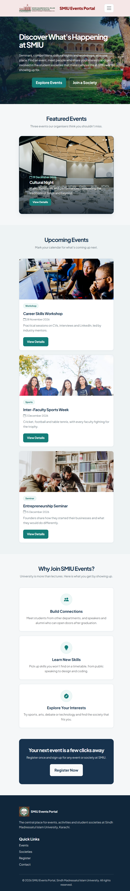

# SMIU Events Portal

## Project Overview
SMIU Events Portal is a university event management website developed for Sindh Madressatul Islam University (SMIU). It provides students with information about university events, societies, registrations, and contact details through a responsive and user-friendly interface.

## Team Members

| Name | Roll Number | GitHub Username |
|---|---|---|
| Laiba Ibrahim | BSE-24S-065 | [laibaibrahim](https://github.com/laibaibrahim) |
| Ansharah | BSE-24S-079 | [Ansharahanif](https://github.com/Ansharahanif) |
| Atiqa | BSE-24S-080 | [atiqaalmansoor](https://github.com/atiqaalmansoor) |
| Saman Fatima | BSE-24S-068 | [SamanFatima24](https://github.com/SamanFatima24) |

## Page Assignments

| Team Member | Assigned Work |
|---|---|
| Laiba Ibrahim | Home Page (`index.html`) and shared CSS (`CSS/style.css`) |
| Ansharah | Events Page (`events.html`) and Event Details Page (`event-details.html`) |
| Atiqa | Societies Page (`societies.html`) and Registration Page (`register.html`) |
| Saman Fatima | Contact Page (`contact.html`) and README documentation |

**Note:** Laiba created the initial shared stylesheet. Other team members added styling for their respective pages to the same CSS file.

## Technologies Used
- HTML5
- CSS3
- Bootstrap 5.3.3
- Bootstrap Icons
- JavaScript
- Git and GitHub

## Project Screenshots

### Home Page – Desktop View

### Home Page – Mobile View

## How to Run the Project

1. Clone or download this repository.
2. Open the project folder in Visual Studio Code.
3. Open the project using the Live Server extension.
4. Launch `index.html` in your browser.
5. Navigate through the website using the navigation bar.

**Note:** An internet connection is required to load Bootstrap and Google Fonts CDN resources.

## Teamwork Challenge and Solution

During development, coordinating changes in the shared CSS file was a challenge because multiple team members were working on different pages using the same stylesheet. We addressed this by coordinating our changes, keeping the shared navbar and footer consistent, and adding page-specific styling carefully. We also used separate Git branches and commits to organize our work and reduce conflicts.

## Repository
[SMIU Events Portal – GitHub Repository](https://github.com/laibaibrahim/smiu-events-portal)